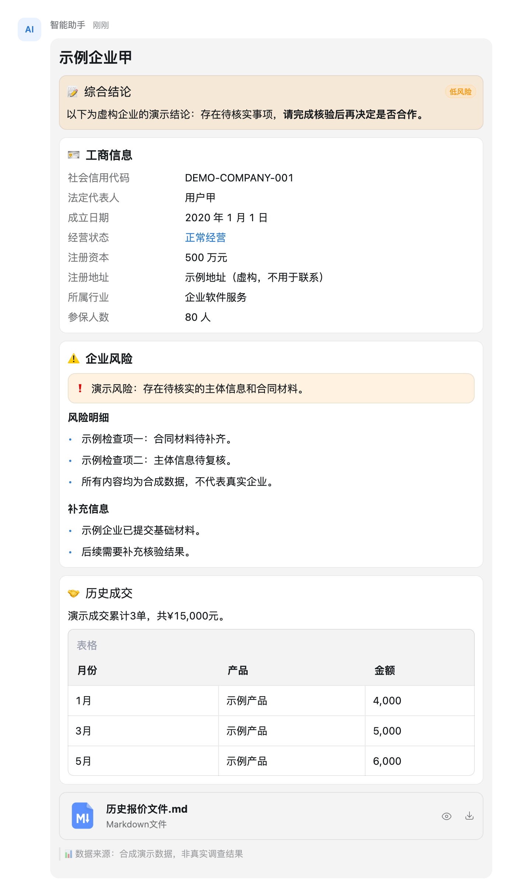
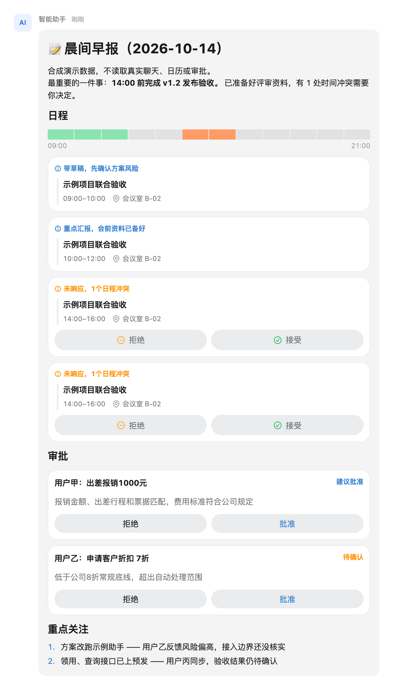
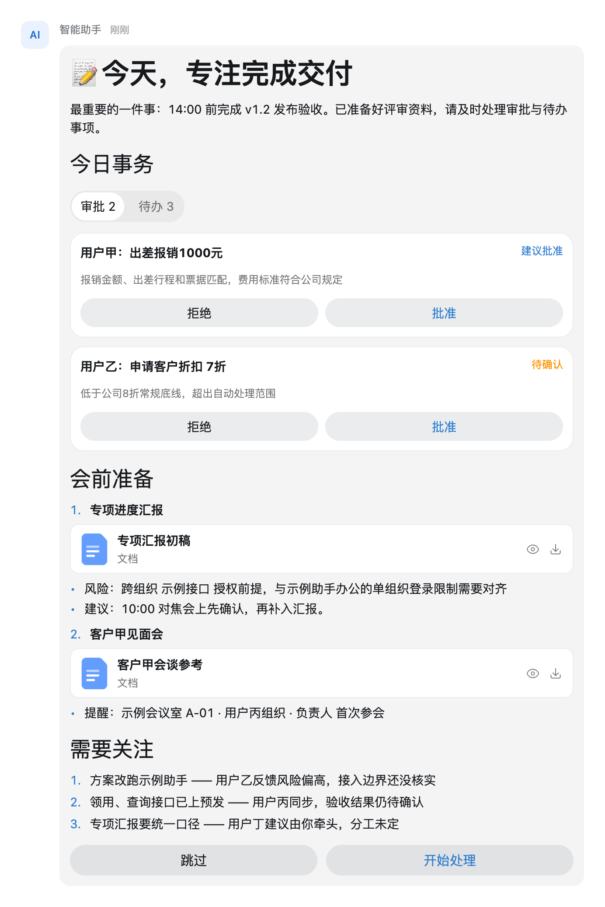
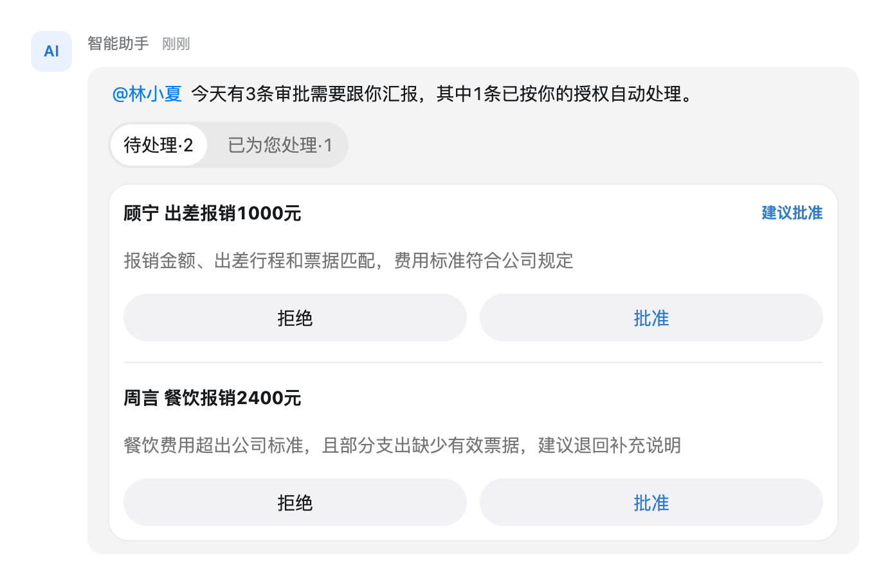
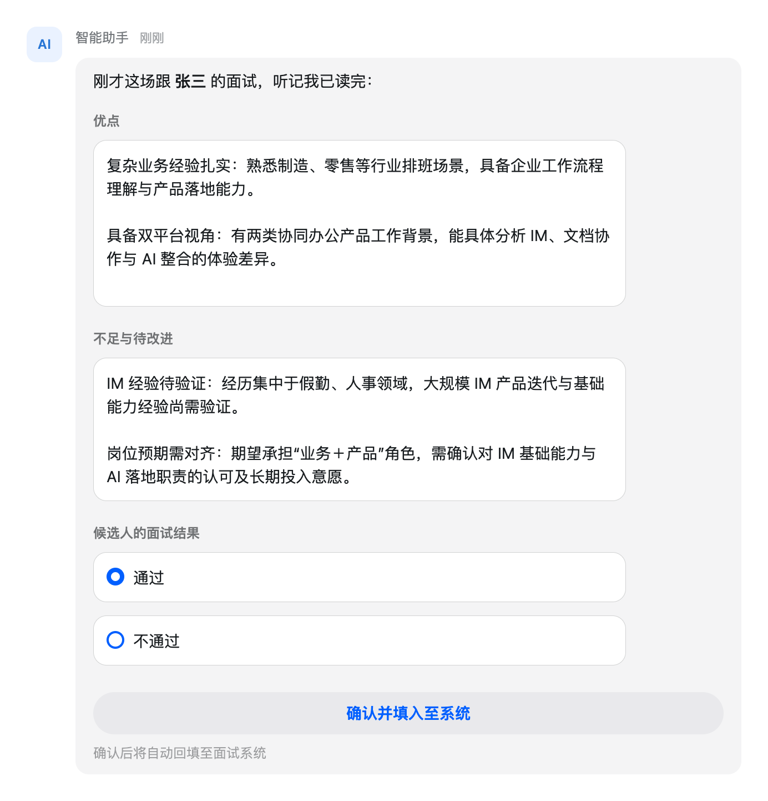
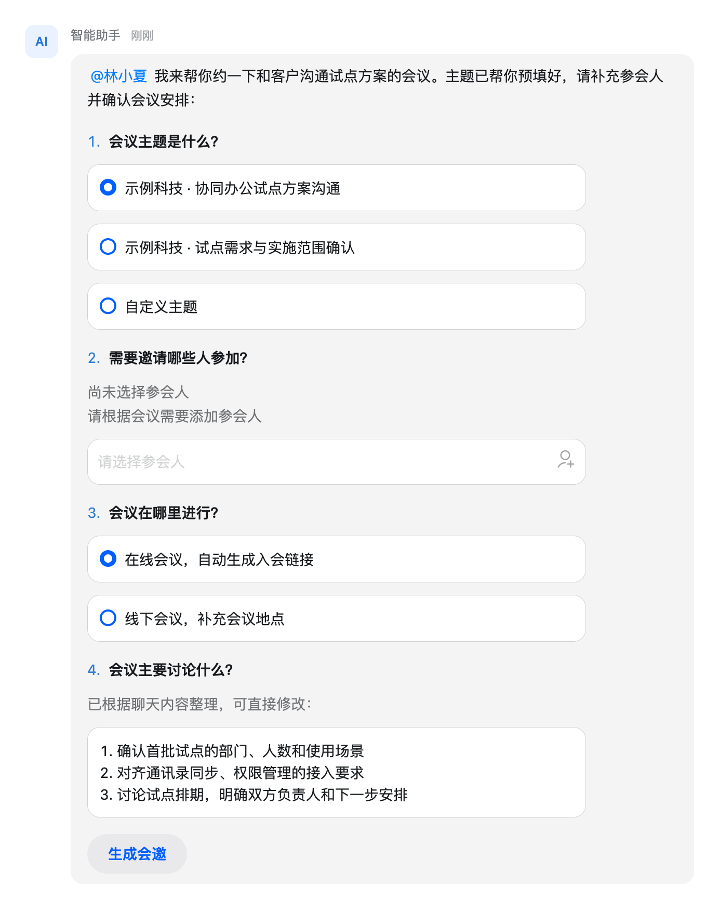
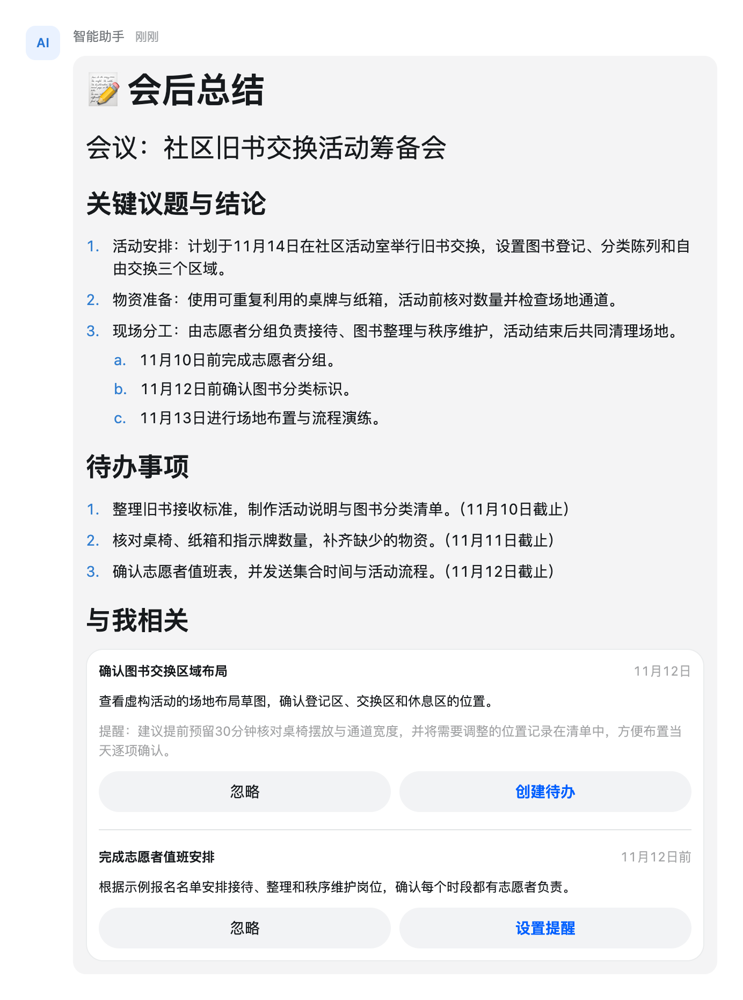
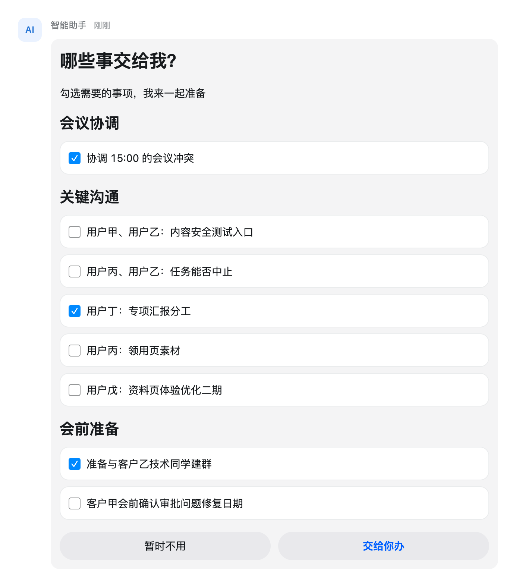
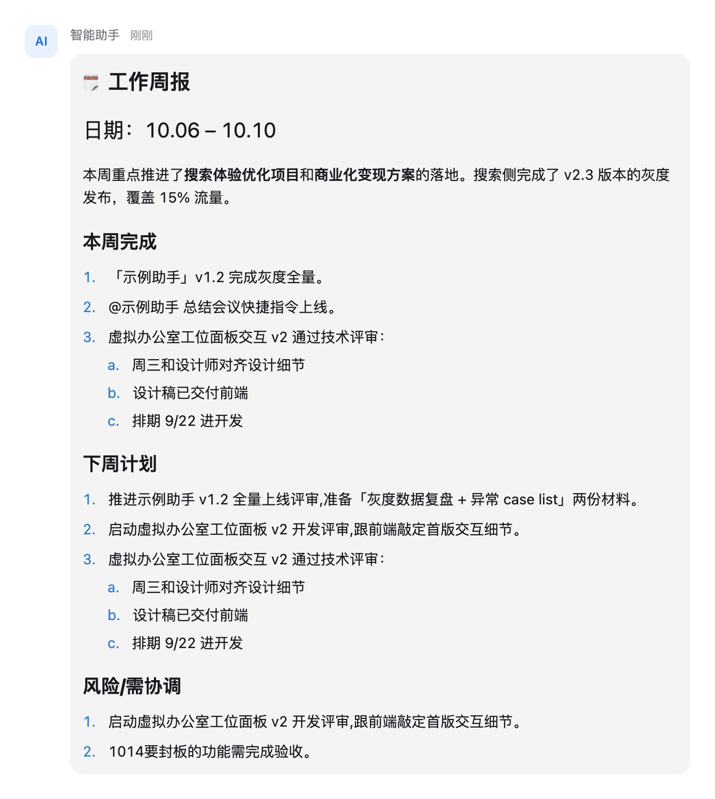

# Built-in card templates

[Back to the project README](../../README.md) · [Template source index](../../skills/dingtalk-aicard/references/templates/README.md)

Explore nine business scenarios with complete A2UI JSON and rendered screenshots.
Chinese scene names and sample card copy are intentionally retained to match the
localized templates. Approval summary includes both tabbed and single-list variants.

The screenshots show the initial state in a local **PC Web SDK preview**, using a
**600 px card width, light theme, and 2× capture resolution**, with a gray
message bubble (`#F4F4F5`) and 12 px corners. A sender row, avatar, and 24 px outer
gutters keep the complete bubble visible in its conversation context. Click a screenshot
to view it at full resolution. Sample content is illustrative; actions require
integration with your application or service.

## Browse templates

| Template | Use case |
| --- | --- |
| [Company information · 企业信息](#company-investigation) | Review a company profile, registration details, risks, transaction history, and report attachments in one card. |
| [Morning briefing · 晨间日报](#daily-agenda-briefing) | Start the day with a schedule timeline, meeting conflicts, pending invitations, and items that need attention. |
| [Today’s tasks · 今日待办事项](#daily-approval-briefing) | Bring approvals, suggested decisions, and meeting preparation materials together around the day’s priorities. |
| [Approval summary · 审批汇报](#expense-approval) | Review pending and completed approvals in separate tabs, with a reason and decision controls for each pending item. |
| [Interview feedback · 面试反馈](#interview-feedback) | Capture interview strengths, areas for improvement, and a recommendation in a structured form. |
| [Meeting invitation · 会议邀约](#meeting-invitation) | Prepare a meeting by choosing its topic, participants, online or offline format, and agenda. |
| [Meeting summary · 会后总结](#post-meeting-summary) | Turn meeting conclusions into a readable summary with action items, due dates, and personal follow-up controls. |
| [Task delegation · 任务处理](#task-delegation) | Select tasks across meeting coordination, communication, and preparation, then hand the selected items to an assistant. |
| [Weekly work report · 工作周报](#weekly-work-report) | Present completed work, next week’s plans, and risks in a structured report with nested lists. |

## Company information · 企业信息

Review a company profile, registration details, risks, transaction history, and report attachments in one card.

[View the complete A2UI JSON](../../skills/dingtalk-aicard/references/templates/company-investigation/a2ui.json)

## Morning briefing · 晨间日报

Start the day with a schedule timeline, meeting conflicts, pending invitations, and items that need attention.

[View the complete A2UI JSON](../../skills/dingtalk-aicard/references/templates/daily-agenda-briefing/a2ui.json)

## Today’s tasks · 今日待办事项

Bring approvals, suggested decisions, and meeting preparation materials together around the day’s priorities.

[View the complete A2UI JSON](../../skills/dingtalk-aicard/references/templates/daily-approval-briefing/a2ui.json)

## Approval summary · 审批汇报

Review pending and completed approvals in separate tabs, with a reason and decision controls for each pending item.

[View the complete A2UI JSON](../../skills/dingtalk-aicard/references/templates/expense-approval/a2ui.json) · [Single-list variant](../../skills/dingtalk-aicard/references/templates/expense-approval-list/a2ui.json)

The screenshot shows the tabbed variant. Use the single-list variant when only one approval category is needed.

## Interview feedback · 面试反馈

Capture interview strengths, areas for improvement, and a recommendation in a structured form.

[View the complete A2UI JSON](../../skills/dingtalk-aicard/references/templates/interview-feedback/a2ui.json)

The screenshot shows the first step. A callback service must save and lock the submitted form, then create the second message for level and comments. Invalid or missing stage values show a non-actionable error; only numeric stages 1 and 2 expose a form.

## Meeting invitation · 会议邀约

Prepare a meeting by choosing its topic, participants, online or offline format, and agenda.

[View the complete A2UI JSON](../../skills/dingtalk-aicard/references/templates/meeting-invitation/a2ui.json)

Custom-topic and offline-location fields depend on client-side visibility reevaluation. Verify these interactions in the target client; this screenshot documents the initial layout.

**Submission:** `meeting_invitation_submit` sends the request ID and current form after required-field validation. A service callback must validate the request, create the meeting, and confirm success; the template does not display a success modal. On the tested Web SDK (3.34.17-beta.103), invalid input reaches a rejection callback, but the local preview host does not display a validation toast. Mobile attendee placeholders remain a known rendering issue.

## Meeting summary · 会后总结

Turn meeting conclusions into a readable summary with action items, due dates, and personal follow-up controls.

[View the complete A2UI JSON](../../skills/dingtalk-aicard/references/templates/post-meeting-summary/a2ui.json)

## Task delegation · 任务处理

Select tasks across meeting coordination, communication, and preparation, then hand the selected items to an assistant.

[View the complete A2UI JSON](../../skills/dingtalk-aicard/references/templates/task-delegation/a2ui.json)

## Weekly work report · 工作周报

Present completed work, next week’s plans, and risks in a structured report with nested lists.

[View the complete A2UI JSON](../../skills/dingtalk-aicard/references/templates/weekly-work-report/a2ui.json)

## Use a template

1. Open the complete JSON linked above and preserve its message structure.
2. Replace sample data, identifiers, attachments, and action destinations with your application’s values.
3. Validate the payload and connect action callbacks to your service before delivery.
4. Verify layout and interaction behavior on the target platforms and themes.
5. To set the finished card's conversation summary, annotate a component whose text is literal or
   bound directly to a data path. The summary does not evaluate functions such as `formatString`
   or `cond`, which many of these templates use.

See the [authoring Skill](../../skills/dingtalk-aicard/SKILL.md) for validation and
delivery guidance.

## Screenshot provenance

Captured on October 21, 2026 from the local Web SDK preview using the template
payloads linked above. The preview uses the published Web SDK with a local
message-host surface: the selected light background `#F4F4F5`,
12 px corners following the IM interactive-card container, and no extra border
or padding inside the bubble. The screenshots include illustrative conversation
chrome outside the SDK card: an avatar, sender name, and outer gutters. This gray presentation is selected for the gallery; native hosts
may use different surfaces. These are browser captures, not native-client screenshots. Only initial states are shown; tabs, form steps, and service responses
can reveal additional content.

Screenshots are stored in [`images/`](images/) next to this page and are linked
by relative paths, so they render in local Markdown previews, clones, and repository
pages. Images omit fixed dimensions so renderers can scale each
thumbnail proportionally. Click any thumbnail to read the complete card at full
resolution.

Refresh the corresponding images when template data, layout, or the preview SDK
changes. Keep temporary capture metadata and verification output locally in
`.analysis-artifacts/`. Overwrite the image under the same file name so the
thumbnail and full-size links keep pointing to it.
